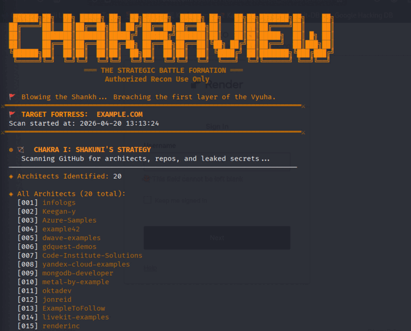

<p align="center">
  
</p>

<h1 align="center">ChakraView</h1>

<p align="center">
  <b>Strategic reconnaissance formation for security researchers.</b><br>
  Ten chakras map a target's external attack surface and hand you the report.
</p>

<p align="center">
  <a href="#install">Install</a> ·
  <a href="#the-ten-chakras">Chakras</a> ·
  <a href="#usage">Usage</a> ·
  <a href="#web-dashboard">Dashboard</a> ·
  <a href="#reports">Reports</a> ·
  <a href="CONTRIBUTING.md">Contributing</a>
</p>

---

In the Mahabharata the *chakravyuha* was a formation nobody could read from
outside. ChakraView turns that around: ten chakras run in order against a
target, each feeding the next, and what comes out is the map — every
subdomain, every live host, every dangling CNAME, every secret shipped to the
browser.

> **Authorised testing only.** Six of the ten chakras send traffic to the
> target: DNS queries, HTTP requests and TCP connections. Run this against
> infrastructure you own or have written permission to test. Use
> `--passive-only` for reconnaissance that touches third-party sources
> exclusively.

---

## Install

Python 3.10 or newer. Four dependencies, nothing compiled.

```bash
git clone https://github.com/mayurie-cysec/chakraview
cd chakraview
pip install -r requirements.txt
```

Optional, and worth doing — a read-only GitHub token unlocks code search,
which is the part that finds committed credentials:

```bash
export GITHUB_TOKEN=ghp_your_readonly_token
```

## Quick start

```bash
python3 chakraview.py -d example.com              # the whole formation
python3 chakraview.py -d example.com -f all       # every report format
python3 chakraview.py -d example.com --passive-only
python3 chakraview.py --serve                     # web dashboard
```

<p align="center">
  
</p>

---

## The ten chakras

| # | Chakra | Key | What it does |
|---|---|---|---|
| I | **Shakuni** | `github` | Org repositories, public members, commit-author emails, and authenticated code search for committed credentials |
| II | **Sanjaya** | `infra` | Every address the apex answers with, enriched with ASN and org, classified as origin / CDN edge / hyperscaler |
| III | **Drona** | `dns` | Full record sweep, SPF and DMARC audit, DKIM selector probing, SaaS tenants in TXT, zone-transfer attempt per nameserver |
| IV | **Ashwatthama** | `archive` | Wayback index sorted into sensitive extensions, admin paths, and query parameters that map to a vulnerability class |
| V | **Karna** | `subs` | Eleven passive sources (eight need no API key) merged with a resolved bruteforce, behind wildcard-DNS detection |
| VI | **Arjuna** | `http` | Status, title, server, tech fingerprint per host, plus exposed `.git`/`.env`, reflected CORS, directory listings, missing security headers |
| VII | **Ekalavya** | `takeover` | 60+ provider fingerprints for dangling CNAMEs, confirmed by two signals rather than one |
| VIII | **Abhimanyu** | `ports` | TCP connect scan with banner grabbing, severity-rated against services that should not face the internet |
| IX | **Sahadeva** | `js` | First-party JavaScript only: API routes the app actually calls, and 21 credential patterns with placeholder filtering |
| X | **Brahmastra** | `dorks` | Dorks built from what the scan found, emitted as live links for Google, GitHub, Shodan, Censys and the CT logs |

Each chakra feeds the next. The archive hands hostnames to enumeration,
enumeration hands live hosts to the prober, the prober hands fingerprints to
the dork generator.

```bash
python3 chakraview.py --list-chakras
```

---

## Usage

```
-d, --domain DOMAIN      Target. A bare domain or a full URL.
-f, --format LIST        txt, json, md, html, or all          (default: txt)
-o, --output DIR         Report directory                      (default: reports)

--only LIST              Run only these chakras
--skip LIST              Skip these chakras
--passive-only           Third-party sources only — nothing reaches the target
--deep                   Raise every cap: 100 ports, more hosts, more scripts

-c, --concurrency N      Concurrent requests                   (default: 50)
-t, --timeout SEC        Per-request timeout                   (default: 10)
-w, --wordlist FILE      Your own subdomain wordlist
--ports PROFILE          top10 | top25 | top100 | 22,80,443    (default: top25)
--max-probe-hosts N      Cap on hosts probed over HTTP         (default: 400)
--verify-tls             Verify TLS certificates (off by default)

--plain                  No colour, no animation — for CI logs and pipes
--quiet                  Summary only
--no-report              Terminal only, write nothing to disk

--serve                  Start the web dashboard
--host ADDR              Bind address                     (default: 127.0.0.1)
--port PORT              Port                             (default: 8787)
```

### Examples

```bash
# everything, every report format
python3 chakraview.py -d target.com --deep -f all

# nothing reaches the target — third-party sources only
python3 chakraview.py -d target.com --passive-only

# just the subdomain work
python3 chakraview.py -d target.com --only subs,http,takeover

# skip the slow parts
python3 chakraview.py -d target.com --skip ports,js --plain

# your own wordlist, wider port sweep
python3 chakraview.py -d target.com -w lists/subs.txt --ports top100
```

### Environment

Every key is optional. ChakraView runs without any of them and reports which
capability each missing key costs.

| Variable | Unlocks |
|---|---|
| `GITHUB_TOKEN` | GitHub code search — the chakra that finds committed credentials |
| `SECURITYTRAILS_API_KEY` | Extra passive subdomain source |
| `VT_API_KEY` | Extra passive subdomain source (VirusTotal) |
| `LEAKIX_API_KEY` | Extra passive subdomain source |
| `OTX_API_KEY` | Richer AlienVault OTX passive DNS |
| `URLSCAN_API_KEY` | Higher urlscan.io rate limit |

---

## Web dashboard

```bash
python3 chakraview.py --serve
```

Serves a landing page at `http://127.0.0.1:8787/` and a scan console at
`/dashboard.html`. Pick a target and the chakras you want, watch all ten run
live over server-sent events, and download the report when it finishes.

The server is standard library only — no extra install — and binds to
loopback. **Whoever can reach the port can start scans against arbitrary
hosts through it**, so put it behind authentication before binding it wider.
It warns you when you do.

---

## Reports

Four formats, written to `reports/` by default.

| Format | Use |
|---|---|
| `html` | Self-contained page, severity filtering, clickable dork links. One file, no external requests — survives being emailed or archived. |
| `json` | Everything, machine-readable. Pipe it into your own tooling. |
| `md` | Drops into a ticket or a pentest report as-is. |
| `txt` | Plain, greppable, diffable between runs. |

Findings carry a severity, the evidence that produced them, and a
remediation line. They roll up into a 0–100 risk score.

> Everything ChakraView produces is **reconnaissance output**, not a confirmed
> vulnerability. Archive and search-engine results show what was once
> reachable, not necessarily what is reachable now. Confirm each item against
> the live target before you report it.

---

## Project layout

```
chakraview.py          CLI entry point
core/
  models.py            Finding, Subdomain, ScanResult — the shared data model
  context.py           Config, the chakra registry, the progress interface
  engine.py            Orchestrator: runs the chakras, isolates their failures
  net.py               Rate-limited async HTTP client, cached DNS resolver
  ui.py                Terminal front end (rich)
  report.py            txt / json / md / html writers
  theme.py             The palette, shared with the web UI
modules/
  shuddhi.py           Sanitizes untrusted text before it is displayed
  shakuni.py  sanjaya.py  drona.py     ashwatthama.py  karna.py
  arjuna.py   ekalavya.py abhimanyu.py sahadeva.py     brahmastra.py
server/app.py          Standard-library web server, SSE scan streaming
web/                   Landing page, dashboard, 404
tools/check_links.py   Link, metadata and accessibility checker for web/
```

### A note on `shuddhi`

Every string ChakraView displays that came from a third party — GitHub logins,
PTR records, page titles, service banners, hostnames from passive sources — is
attacker-influenced. Raw ANSI escapes in that data let a target repaint your
terminal: clear reported findings with `\x1b[2K`, move the cursor with
`\x1b[H`, retitle the window with an OSC sequence. HTML in it would do the
equivalent to the report. Everything externally sourced goes through
`shuddhi.sanitize()` before display and `shuddhi.escape_html()` before it
reaches a report.

---

## Contributing

See [CONTRIBUTING.md](CONTRIBUTING.md). Adding a chakra is three steps: write
`async def run(ctx)` in `modules/`, add an entry to `CHAKRAS` in
`core/context.py`, and map the key in `RUNNERS` in `core/engine.py`.

Before opening a PR that touches `web/`:

```bash
python3 tools/check_links.py --external
```

## Licence

MIT.
